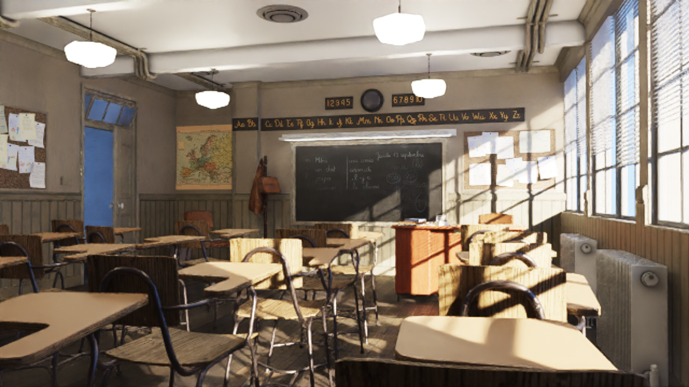

# Classroom reconstruction on the Mac

The [interactive comparison](../pages/nrc-classroom-quality.html) renders the same Classroom camera and daylight with five NRC presets. Run `node bench/live.ts nrc-classroom-quality` and choose **Run Classroom comparison**. The [hero setup guide](../hero/README.md) covers the scene assets.

### November 20, 2026 • Apple GPU, Chrome WebGPU

Each case starts a fresh compact MLP, traces one sample per pixel per frame, and trains continuously. The first eight frames use the plain-path warm-up gate. At frame 49 the progressive cases have 41 post-gate samples per pixel. The render size is 640 × 360, the temporal output is 1280 × 720, and the firefly clamp is off. OIDN uses the small network while moving and the standard network after eight still frames, with holding disabled. All cases use the same eight-frame training gate for this comparison.

| Training / accumulation / denoiser | Raw patch flicker | Denoised patch flicker | Final patch flicker | Final error vs. plain | Median frame |
| --- | ---: | ---: | ---: | ---: | ---: |
| Tiles / fresh / SVGF | .1271 | .0545 | .0030 | .0761 | 82.3 ms |
| Pixels / fresh / SVGF | .1263 | .0540 | .0030 | .0768 | 87.0 ms |
| Pixels / accumulated / SVGF | .0097 | .0237 | .0021 | .0669 | 82.3 ms |
| Tiles / accumulated / SVGF | .0096 | .0237 | .0021 | .0667 | 79.1 ms |
| Tiles / accumulated / OIDN | .0097 | .0096 | .0012 | .0583 | 129.0 ms |

Patch flicker measures the 99th percentile absolute change in mean display luminance over 8 × 8 render-pixel patches across eight frame pairs. Final error is mean absolute display-luminance difference from an independently seeded 256-spp plain path trace at render resolution. The reference retains Monte Carlo noise. Frame time includes trace, training and reconstruction, waits for GPU completion and excludes readback. These are stationary-camera results from one run per preset.

Individual-pixel training barely changed this patch metric. Pre-denoiser accumulation produced the largest reduction in raw variation. At 41 spp, SVGF reintroduced some local variation and temporal upscaling suppressed much of it. OIDN gave the lowest final error and patch flicker with a higher frame cost. Use the raw/denoised/final selector to inspect the same surfaces. The native screenshot also shows finer blind stripes and sharper board and clock detail. This benchmark does not measure moving-camera ghosting or establish parity with the native renderer.

### Stationary grain after the initial settle

On the Mac, a 480 × 270 Classroom render with temporal 2× output, live compact-MLP training and one traced sample per pixel per frame reproduced a rise in spatial grain after the first 32 frames. The raw sample mean continued to improve in both arms. The rise appeared in the SVGF output and carried through to the upscaler. SVGF estimates variance from successive inputs. As the cumulative input changes less each frame, spatial noise can remain even when temporal variance is small.

| Frame | Raw NRC, unlimited | Final NRC, unlimited SVGF input | Final NRC, 16-sample SVGF input |
| ---: | ---: | ---: | ---: |
| 32 | .14080 | .00941 | .00936 |
| 128 | .08164 | .01297 | .00862 |
| 256 | .06232 | .01461 | .00886 |
| 512 | .04770 | .01322 | .00832 |
| 1024 | .03806 | .01136 | .00852 |

The metric averages the absolute difference between a pixel's tone-mapped luminance and its four neighbors over three fixed ceiling and wall patches. It measures local grain and also picks up real texture. Compare each stage at the same resolution. The 16-sample input reduced NRC final grain by 39% at frame 256 and 25% at frame 1024. At frame 1024 it also reduced plain PT final grain from .01232 to .00871. Neither arm reached a nonfinite value at the measured checkpoints. These results cover a stationary camera and the SVGF path.

The interactive bench defaults to a 16-sample effective history for the SVGF signal planes. The raw PT and NRC beauty buffers continue accumulating every sample. The **Test stationary grain** button reruns the unlimited and bounded variants with a fresh cache per case.

### Color Sponza after 1,024 stationary frames

The [Sponza stationary test](../pages/nrc-classroom-quality.html?scene=hero-sponza) uses the same 480 × 270 render, 960 × 540 output, warm-up gate, continuous training and grain metric as the Classroom test. Three patches were selected from a preview before comparing settings. They cover the shaded left foreground column, the masonry above the far arch and the center aisle floor. Each column below reports final grain after temporal upscaling on the Mac.

| Frame | Plain PT, unlimited | Plain PT, 16 samples | NRC, unlimited | NRC, 16 samples |
| ---: | ---: | ---: | ---: | ---: |
| 8 | 0.00639 | 0.00639 | 0.00629 | 0.00629 |
| 32 | 0.00484 | 0.00470 | 0.00431 | 0.00431 |
| 64 | 0.00584 | 0.00428 | 0.00487 | 0.00402 |
| 128 | 0.00811 | 0.00397 | 0.00754 | 0.00387 |
| 256 | 0.00908 | 0.00417 | 0.00899 | 0.00400 |
| 512 | 0.00776 | 0.00397 | 0.00764 | 0.00396 |
| 1024 | 0.00629 | 0.00414 | 0.00617 | 0.00405 |

Both settings gave the same final NRC grain at frame 32 to the precision shown. With unlimited input history it more than doubled by frame 256. With 16 samples it stayed near .004. At frame 1024 the cap reduced final grain by 34% in both arms. The difference was already visible at the denoiser output for NRC (.01395 vs. .01001), while its raw grain was nearly identical (.01645 vs. .01644). Plain raw grain was .01733 in both runs.

Keep 16 as the interactive SVGF input default for these two interiors. This A/B covers one stationary camera per scene. The local-contrast metric includes real surface detail and measures neither motion ghosting nor accuracy against a converged reference.
