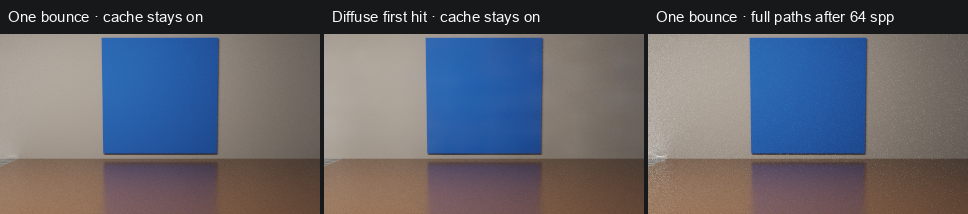

# Directional hash, wall grid and temporal noise

The RGB hash is the least expensive of the tested representations for the blue-card fixture on the M5 Pro. The compact MLP tracked moving grazing highlights slightly better. First-order spherical harmonics (SH) helped on a known angular signal, but added little image quality when the first glossy bounce was already traced. All four rendering arms use raw RGB, query at the second hit, and keep the cache active throughout accumulation. The MLP uses the reflected direction, four position bands and three 32-wide hidden layers. [Preset](../nrc/phase10.ts) · [Phase 9 baseline](NRC-SHADOWS-REFLECTIONS.md)

## Matched camera and memory

Chrome 157 on Apple M5 Pro, portable tiled fp16 for the MLP, 320 × 180. Paired A/B/B/A, two runs per arm. The static result is a 256-spp accumulation after 256 frames of online training. The blue-card reference has 4,096 traced spp. Reflection contrast measures blue minus red relative to the floor on either side. The five grazing views use 64-spp frozen predictions against independent 1,024-spp same-camera references. Frame cost includes training and rendering on a shared desktop. [Camera sweep and metrics](../pages/nrc-study.ts)

| Representation | Blue reflection contrast recovered | Reflection relative RMS | Wall stripe RMS | Card / grazing frame (ms) | Moving-highlight normalized MSE |
|---|---:|---:|---:|---:|---:|
| Compact MLP | 98.80% | 5.76% | 0.552% | 1.70 / 1.45 | 0.1058 |
| Hash with RGB mean | 98.94% | 5.79% | 0.578% | 1.05 / 0.90 | 0.1089 |
| Hash with 4 × 4 direction bins | 98.94% | 5.79% | 0.591% | 1.00 / 0.90 | 0.1089 |
| Hash with first-order SH | 98.94% | 5.79% | 0.591% | 1.20 / 0.90 | 0.1089 |

Single-frame reflection flicker, measured as mean absolute change over mean reference luminance, was 1.085 for the MLP and 1.088 for all three hashes on the card. On the grazing ramp it was 0.813 and 0.835 respectively. This metric includes Monte Carlo noise from the traced bounce and direct light. Bright-region energy bias across the grazing poses was −0.91% for the MLP and about −1.42% for the hashes. Renderer run IDs, November 19 UTC, are 100534Z, 100538Z, 100541Z and 100544Z.

Each renderer hash received exactly 10,485,844 bytes including auxiliary storage. RGB and bins had 262,144 entries each, SH had 40,960. The MLP used 18,016,672 bytes for its engine weights and scratch at this resolution, including 8,384 bytes of inference weights. Common path and training-record buffers are excluded from these figures. Of 9,260 occupied SH cells in the card view, 818 had a supported directional fit. At grazing it was 2,443 of 25,489. The smaller SH table dropped about 24 cell insertions per grazing frame versus zero for the RGB table. All three use the evaluated material roughness, geometric normal key and outgoing world-space direction. [Hash implementation](../nrc/hash-grid.ts)

## Angular behavior and update cost

The directional representation fits one constant and three linear direction terms per RGB channel. It estimates centered, regularized moments of the observed directions and bounds the slope to keep radiance nonnegative. Insufficient samples, insufficient angular spread and ineligible roughness fall back to the RGB mean. The direction-bin arm uses the historical 4 × 4 octahedral layout. [MobileRC](https://doi.org/10.1111/cgf.70537) · [Earlier bin experiment](../../docs/design/nrc-hash-cache.md)

| Analytic held-out directions, relative RMS | RGB | Bins | SH |
|---|---:|---:|---:|
| Linear radiance over the sphere | 0.306 | 0.116 | 0.017 |
| Broad lobe | 0.650 | 0.243 | 0.351 |
| Sparse observations | 0.251 | 0.510 | 0.251 |
| Narrow observed direction range | 0.291 | 0.662 | 0.291 |
| Sharply peaked lobe | 0.916 | 0.602 | 0.803 |

The constrained SH fit produced zero negative channels on the peaked lobe. The unconstrained CPU fit went negative on 398 of 1,536 channels. The SH fit still overestimated mean dark-region radiance by 0.094 versus 0.013 for the bins. Regularization and bounds prevent negative ringing while retaining a visibly broadened peak.

For eligible directional samples, the hash accumulator performs four atomic additions per updated RGB or bin cell and 25 per SH cell. A read and write of each 32-bit word corresponds to 32 versus 200 logical bytes per record per updated level. At 16,384 records and one level that is 0.50 versus 3.125 MiB. Actual DRAM traffic depends on cache residency, contention, key probing and the resolve pass. The separate GPU oracle exercised both distributed records and hot cells, checked lookup parity and eviction, and timed the actual GPU passes (100922Z). A cold-insert stress test exposed a race that could place one key in multiple slots. The insertion path now recognizes a winning writer before advancing, and the renderer runs above were repeated after the fix. [Directional oracle](../pages/nrc-directional-check.ts)

## Thin surfaces and moving objects

The 8 mm partition produced the largest difference between the MLP and the hash. The red-side and blue-side wall/floor seam crops below use independent 4,096-spp PT references and 256-spp frozen probes after 384 training frames at 256 × 144. Opposite-colored light in the traced solution is retained in the reference. The side-specific color statistic measures excess above that reference. [Locality benchmark](../pages/nrc-locality.ts) · [On-surface caching](https://doi.org/10.1145/3675382)

| Representation | Red / blue seam crop relMSE | Excess opposite color, red / blue (percentage points) | Moving-card crop relMSE immediately after edit / after 64 / after 256 updates |
|---|---:|---:|---:|
| Compact MLP | 0.209 / 0.087 | +5.45 / +3.54 | 0.0305 / 0.0123 / 0.00486 |
| RGB | 0.00378 / 0.00311 | +0.030 / +0.012 | 0.0857 / 0.00542 / 0.00433 |
| Bins | 0.00280 / 0.00308 | +0.047 / +0.041 | 0.0846 / 0.00445 / 0.00308 |
| SH | 0.00311 / 0.00277 | +0.037 / +0.032 | 0.0855 / 0.00588 / 0.00472 |

The MLP error concentrates near the seam. On a floor-only interior crop its relMSE was 0.00314 / 0.00247. Widening the partition from 8 mm to 32 cm reduced MLP seam relMSE to 0.0319 / 0.0084. After moving the physical card, the MLP initially retained more accurate reflection color, while all three hashes recovered more quickly with online updates. This fixture supports retaining the existing normal keys. Same-facing, coplanar surfaces still need their own evidence before introducing instance keys.

## Why the demos look different

The earlier first-hit setup asks the network to predict the reflected object and produces a low-noise image with a spatial grid and a weak reflection. Fixed second-hit caching samples visibility and BSDF variation explicitly. The former live link additionally switched to full PT after 64 samples. These are separate changes. Each row below starts from an empty film and a cold four-band MLP at identical camera, lighting and training settings, on the blue-card fixture. Grain is the RMS of horizontal and vertical adjacent differences in the wall luminance residual, divided by √2 and by the mean reference luminance.

| Display policy | Wall grain at 64 / 256 / 512 spp | Shadow-edge relative RMS at 512 spp | Blue reflection contrast at 512 spp |
|---|---:|---:|---:|
| First hit on every surface | 5.34 / 3.12 / 2.55% | 6.93% | 58% |
| One traced bounce on every surface | 5.69 / 3.24 / 2.63% | 3.65% | 97% |
| First hit on diffuse, one bounce on other surfaces | 5.34 / 3.12 / 2.55% | 5.54% | 98% |
| One bounce, then full PT for new samples after 64 | 5.69 / 6.60 / 5.08% | 5.62% | 99% |



The diffuse-first experiment preserves the floor reflection while recovering the earlier smooth wall appearance. The cost is persistent bias at the card edge. The fixed second hit remains the comparison baseline. Full-path refinement improves eventual consistency but initially increases visible noise. The result at 393 spp in the user screenshot came from the earlier first-hit demo. Its exact camera pose is unavailable. Noise runs 100218Z, 100220Z and 100223Z.

## Reproduction

From the pathtracer root, run the following A/Bs. Replace `mlp,rgb` with `bins,sh` for the other pair. Reproduce the grazing sweep with `scene=nrc-materials-grazing crop=metal motionViews=5 motionSpp=64 motionRefSpp=1024 refSpp=1024`.

```sh
node bench/runner/run.ts --page nrc-study --gpu apple --repeat 2 --no-csv --ab phase10=mlp,rgb --args scene=nrc-materials-card scenario=static res=320x180 refSpp=4096 frames=16,64,256 warm=0 steps=2 flip=0
node bench/runner/run.ts --page nrc-directional-check --gpu apple --repeat 2 --no-csv --args memoryMiB=10 timeFrames=64
node bench/runner/run.ts --page nrc-locality --gpu apple --no-csv --args fixture=thin arm=mlp
node bench/live.ts nrc-live --no-open
```

Append `?scene=nrc-materials-card&phase10=mlp&res=640x360&refineStill=0` to the printed live URL. Select a matched-memory hash from the Cache menu or use `phase10=rgb`, `bins`, or `sh`. Keep the camera stationary to compare sample counts. The optional `queryDepth=diffuse-first` link setting changes the display boundary. The study never applies still refinement in a phase 10 arm.
