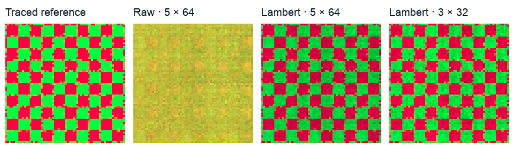

# NRC reflectance factorization and compact networks on the Mac

November 19, 2026. Apple M5 Pro, Metal, headless Chrome 157. Both experiments use the phase 5 evaluated material inputs. Phase 6 holds the five-layer network fixed and changes the training target. Phase 7 holds the raw RGB target fixed and changes the hidden layers. All performance and quality comparisons use portable fp16 kernels. [Execution plan and references](../../docs/design/nrc-experiments.md)

## Phase 6 · Reflectance factorization

With `materialInputs=evaluated`, `factorization=lambert` divides the indirect training target by the hit's textured diffuse reflectance. `factorization=reflectance` also divides rough-conductor targets by their RGB normal-incidence Fresnel reflectance (F0). The network's inference store restores physical radiance once. Both display resolve and training-tail bootstrap read that value. Direct light and primary emission use their ordinary path-traced values. `factorization=off` selects the raw target. [NRC paper, §5](https://research.nvidia.com/publication/2021-06_real-time-neural-radiance-caching-path-tracing) · [Implementation](../nrc/cache.ts)

A zero Lambert channel has zero indirect target and zero decoded radiance. Positive Lambert channels use a minimum factor of 1/1024. Metals use a floor of 1/16 because a small F0 can still produce a bright reflection at grazing angles. The same scales apply in both directions. These floors are experiment settings. Delta, layered, transmission and fuzz surfaces retain a unit factor.

**Saturated diffuse texture.** A Lambert checker under a unit sky gives a traced reference at each pixel. The cache and reference use identical camera jitter, seed and sample index. The harness checks the primary albedo pixel by pixel and reads a fresh, single-sample frame at each training age. Contrast is mean saturated-channel radiance minus mean black-channel radiance, with an ideal value of 1. Bias is in linear radiance units. Each entry is the median of two runs. [Fixture and metrics](../nrc/factor-check.ts)

| Network | Target | Frame 16 black bias | Frame 16 saturated bias | Frame 16 contrast | Frame 256 black bias | Frame 256 contrast | Frame 256 normalized MSE |
|---|---|---:|---:|---:|---:|---:|---:|
| 5 × 64 | Raw | +0.495 | −0.447 | 0.057 | +0.0032 | 0.997 | 0.00034 |
| 5 × 64 | Lambert | 0 | −0.354 | 0.646 | 0 | 1.001 | 0.00052 |
| 3 × 32 | Raw | +0.507 | −0.486 | 0.007 | +0.0065 | 0.994 | 0.00037 |
| 3 × 32 | Lambert | 0 | −0.197 | 0.803 | 0 | 1.004 | 0.00189 |

At frame 16 the full model's whole-image normalized MSE fell from 0.433 to 0.133 and the compact model's from 0.483 to 0.053. At frame 256 raw RGB had lower average squared error on both models, while factorization still eliminated measured leakage on black channels. The useful case here is preserving high-frequency material detail during startup. Indoor GI includes spatially varying incident lighting, which this fixture holds constant.



The crops show one measured run per arm with identical linear-to-sRGB display conversion and nearest-neighbor enlargement.

**Glossy reflections.** The camera sees a normal-mapped conductor roughness ramp beside coated plastic. We used 160 × 90, a 512-spp static reference, three moving views with 256-spp references, and a primary-vertex cache query. Each table cell is the median of two runs per arm in A/B/B/A order. The first column of errors covers the first 256 accumulated frames. The next accumulation starts with those learned weights. Each comparison has its own control. [Fixture](../scenes/tier2/nrc-materials.ts) · [Study](../pages/nrc-study.ts)

| Paired comparison | Target | Cold glossy relMSE | Next 256 glossy relMSE | Last-view temporal error |
|---|---|---:|---:|---:|
| Raw vs both lobes | Raw | 0.0467 | 0.0279 | 4.641 |
| | Lambert + conductor | 0.0560 | 0.0275 | 4.618 |
| Conductor ablation | Lambert only | 0.0558 | 0.0301 | 4.646 |
| | Lambert + conductor | 0.0550 | 0.0261 | 4.642 |

Cold glossy error increased about 20% against raw RGB. The later measurements and camera moves give little evidence for a general reflections improvement. Keep raw RGB as the reflections control.

**Transport and reconstruction checks.** In a closed room with unit emission and RGB albedo (0, 0.5, 0.75), the exact beauty is (1, 2, 4). The frozen network reproduced it within 9.6 × 10⁻⁷ at display depths 0, 4 and 6 around a training boundary of 4. Its nonzero training-tail loss stayed below 6 × 10⁻¹⁴ on both fp16 kernels. Beauty recomposed from diffuse × albedo + specular × specular factor + emission within 2.4 × 10⁻⁷. A rough dark-metal hit under a unit sky gave a separate single-sample test of training normalization against the traced suffix, including F0 below the floor. Its fp16 loss differed from the CPU oracle by 3.5 × 10⁻⁶. Smooth and fuzz-covered metal passed the same check with unit factors. Normal-mapped metal, coated plastic and diffuse panels also passed the feature and reconstruction checks. [Transport checks](../nrc/factor-check.ts) · [Material oracle](../nrc/material-check.ts)

## Phase 7 · Three 32-wide hidden layers

Both networks receive 64 inputs and predict RGB. Reducing the hidden layers from 5 × 64 to 3 × 32 takes the dense network from 20,672 to 4,192 multiply-accumulates per query. The allocated MLP buffers including training scratch space fell from 29.58 to 17.18 MiB. The fp16 inference weights alone fell from 41,344 to 8,384 bytes. The tiled inference path uses eight of 16 column lanes in each compact hidden layer and one at the RGB output. The sampled frame had 56,754 queries, 14 padding records, and 13,786 training records in every arm. [Network configurations](../../packages/mlp/src/config.ts) · [Mobile NRC reference](https://traverse.nl/insights/mobile-nrc-publication/)

**Glossy Sponza, 320 × 180.** All arms use the same camera, evaluated inputs, raw target, update fraction, two optimizer steps per frame, and a 512-spp path-traced reference. The floor crop covers the middle half of the image width and the lower part of the floor. Times are medians of the two per-run medians from A/B/B/A. The whole-frame figure includes tracing and training. Stage times use separate submissions and queue completion. The runner reported background GPU processes, so use the paired values as shared-desktop measurements. [Study and timing protocol](../pages/nrc-study.ts)

| Portable fp16 kernel | Network | Whole frame | Inference stage | Training steps | Cold full-frame relMSE at 256 | Cold glossy relMSE at 256 | Next 256 glossy relMSE |
|---|---|---:|---:|---:|---:|---:|---:|
| Tiled | 5 × 64 | 6.05 ms | 1.80 ms | 2.15 ms | 0.0480 | 0.0620 | 0.0426 |
| Tiled | 3 × 32 | 4.65 ms | 1.10 ms | 1.30 ms | 0.0570 | 0.0798 | 0.0550 |
| Per record | 5 × 64 | 13.70 ms | 9.35 ms | 2.40 ms | 0.0461 | 0.0581 | 0.0445 |
| Per record | 3 × 32 | 5.80 ms | 2.30 ms | 1.45 ms | 0.0566 | 0.0765 | 0.0472 |

The compact network reduced whole-frame time by 23% with tiled inference and 58% with per-record inference. At matched frame count the full network had lower glossy error on both backends. Giving the compact tiled network 336 frames produced glossy relMSE 0.0824 and full-frame relMSE 0.0552, compared with 0.0620 and 0.0480 for the full network at 256 frames. Estimated rendering budgets were 1.50 and 1.55 seconds respectively, computed from each run’s median steady-frame time. Extra compact frames did not recover the glossy quality gap in this scene.

**Light edit.** After 64 warm-up frames and one baseline capture, we rotated the sun azimuth 180° in the existing scene buffers, retaining the camera, network and optimizer. The edited reference differed from the previous one by relMSE 1.52. Each checkpoint below uses a fresh one-sample frame and the edited 512-spp reference. The ordering changes with frame and kernel, so this experiment gives no clear recovery advantage to either network. [Lighting scenario](../pages/nrc-study.ts)

| Glossy crop relMSE after edit | Frame 1 | Frame 16 | Frame 64 | Frame 256 |
|---|---:|---:|---:|---:|
| Tiled, full / compact | 0.870 / 0.881 | 1.016 / 1.028 | 0.730 / 0.726 | 0.770 / 0.785 |
| Per record, full / compact | 0.887 / 0.868 | 1.018 / 1.018 | 0.733 / 0.723 | 0.780 / 0.772 |

**Denoised diffuse GI.** We also ran the compact network through SVGF and the 2× upscaler on Sponza-white, starting cold at 320 × 180 and scoring the 640 × 360 output against the 4,096-spp Mitsuba reference. At frame 16 the raw target gave final relMSE 0.0884, Lambert factorization gave 0.0952, and the one-sample plain path tracer gave 0.0627 through the same pipeline. The checker startup gain did not carry over to this reconstructed indoor frame. The pipeline study now adds the emission plane when checking beauty reconstruction. The identity was exact in all four runs. [Pipeline study](../pages/nrc-pipeline-study.ts)

**Using the experiments.** The live NRC and pipeline demos accept `?network=compact&factorization=lambert` for a fast diffuse preview. A factorized target selects evaluated inputs automatically. Use `network=default&materialInputs=evaluated&factorization=off` for the measured glossy control. The compact GPU oracle passed on a partial last workgroup. Trained compact weights reset and reloaded on both kernels. Treat a saved network as specific to its shape, material encoding, coordinate transform and target convention. This experiment covers the pathtracer cache on the Mac. Windows subgroup-matrix/WebNN timing and integration in the separate reflections library remain open. [MLP checks](../pages/mlp-check.ts) · [NRC checks](../pages/nrc-check.ts)

## Reproduction

Run from the pathtracer root. Each study saves its linear HDR images and matching reference under `bench/results/incoming/<run-id>`.

```sh
node bench/runner/run.ts --page nrc-check --gpu apple --repeat 2 --ab factorization=off,lambert --args check=checker infer=tiled precision=f16
node bench/runner/run.ts --page nrc-check --gpu apple --ab infer=portable,tiled --args check=factor-room factorization=reflectance precision=f16
node bench/runner/run.ts --page nrc-check --gpu apple --ab factorization=lambert,reflectance --args check=factor-metal infer=tiled precision=f16
node bench/runner/run.ts --page nrc-check --gpu apple --ab factorization=lambert,reflectance --args check=materials infer=tiled precision=f16
node bench/runner/run.ts --page nrc-study --gpu apple --repeat 2 --ab factorization=off,reflectance --args materialInputs=evaluated scene=nrc-materials scenario=static res=160x90 refSpp=512 frames=1,16,256 warm=0 infer=tiled precision=f16 queryDepth=0 flip=0 motionViews=3 motionRefSpp=256
node bench/runner/run.ts --page nrc-pipeline-study --gpu apple --repeat 2 --ab factorization=off,lambert --args materialInputs=evaluated network=compact infer=tiled precision=f16 scenarios=static denoiser=svgf res=320x180 warm=0 frames=16 checkpoints=1,16 plainSpp=1 steps=2 ref=mitsuba flip=0
node bench/runner/run.ts --page mlp-check --gpu apple --ab infer=portable,tiled --args network=compact precision=f16 records=67 capacity=128
node bench/runner/run.ts --page nrc-check --gpu apple --ab infer=portable,tiled --args network=compact precision=f16 materialInputs=evaluated
node bench/runner/run.ts --page nrc-study --gpu apple --timeout 600000 --repeat 2 --ab network=default,compact --args scene=sponza-glossy scenario=static res=320x180 ref=ours refSpp=512 frames=1,16,256 warm=0 infer=tiled precision=f16 materialInputs=evaluated factorization=off flip=0
node bench/runner/run.ts --page nrc-study --gpu apple --timeout 600000 --repeat 2 --ab network=default,compact --args scene=sponza-glossy scenario=lighting res=320x180 ref=ours refSpp=512 frames=1,4,16,64,256 warm=64 infer=tiled precision=f16 materialInputs=evaluated factorization=off flip=0
```

For the compact checker add `network=compact` to the first command. For the conductor ablation use `--ab factorization=lambert,reflectance` on the material study. For per-record inference use `infer=portable` on both Sponza commands. To reproduce the equal-budget follow-up, select `network=compact` in the static tiled run and add frame 336.

Saved run IDs on November 19, 2026 (UTC prefix `20261119T`):

| Comparison | Run suffix |
|---|---|
| Full and compact checker | `041526Z-nrc-check`, `041529Z-nrc-check` |
| Roughness ramp, raw vs both and Lambert vs both | `040632Z-nrc-study`, `040656Z-nrc-study` |
| Fixed point, panels, dark metal, exempt lobes, fp32 oracles | `040848Z-nrc-check`, `040853Z-nrc-check`, `041533Z-nrc-check`, `041537Z-nrc-check`, `041539Z-nrc-check` |
| SVGF and 2× upscaling, Sponza-white | `042006Z-nrc-pipeline-study` |
| Compact numerical and reload checks | `040709Z-mlp-check`, `040923Z-nrc-check` |
| Tiled static and light edit | `040903Z-nrc-study`, `040905Z-nrc-study` |
| Per-record static and light edit | `040908Z-nrc-study`, `040911Z-nrc-study` |
| Compact tiled, 336-frame budget | `041134Z-nrc-study` |
