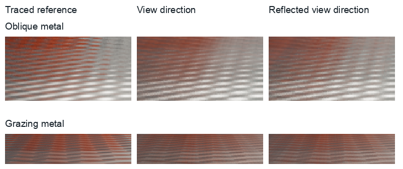

# Reflected direction on the compact NRC network

November 19, 2026. On the Apple M5 Pro, reflecting the view vector reduced average glossy crop error at both camera heights. It tracked moving highlights better on the oblique roughness ramp. At grazing angles it reproduced the average image more closely while tracking changes in the brightest reflections less accurately. Keep the view input as the control and the reflected input available for comparison. [Execution plan](../../docs/internal/design/nrc-experiments.md)

## Results

Both arms learned raw outgoing indirect RGB with the same 64-input, 3 × 32 network. In the reflected arm the eight direction features encode `reflect(-wo, shadingNormal)`, where `wo` points from the hit toward the previous vertex. The normal features still encode the evaluated shading normal. Roughness, texture inputs, record stride, training sampling and the 4,192 MACs per inference match the control. The hook uses the same expression when writing a training record or a display/bootstrap query. This tests the directional input separately from the prefiltered specular target proposed in the paper. [Cache implementation](../nrc/cache.ts) · [Klepikov and Frolov](https://arxiv.org/abs/2610.11702)

| Five-view metal crop | Metric | View | Reflected | Change in error |
|---|---|---:|---:|---:|
| Oblique, 61–71° | Average image relMSE | 0.0303 | 0.0253 | −17% |
| | Moving-highlight normalized MSE | 0.0996 | 0.0629 | −37% |
| Grazing, 80–84° | Average image relMSE | 0.0293 | 0.0261 | −11% |
| | Moving-highlight normalized MSE | 0.2066 | 0.2456 | +19% |

Angles are relative to the geometric floor normal over the metal pixels in the five crops. Local shading normals vary under the normal map. For each pose the network was held fixed and rendered at 64 samples per pixel against a matching 1,024-spp traced reference. For moving-highlight error, select the brightest tenth of reference pixels in either of two successive views. Sum squared errors in the predicted change in luminance over those pixels, then divide by the summed squared reference change. Each run averages five image errors and four transition errors. The table reports the median across four runs per input, using A/B/B/A at each of two network seeds (1 and 17). The reference images were byte-identical between arms. [Metrics and camera sweep](../pages/nrc-study.ts) · [Material fixture](../scenes/tier2/nrc-materials.ts)

**Sampling check.** At 256 spp against 4,096-spp references, a separate seed-17 pair gave highlight-motion errors of 0.0624 → 0.0255 oblique and 0.1522 → 0.1594 grazing. The grazing penalty shrank to 4.7% but retained its sign. In the main runs, signed bright-region energy bias went from −4.0% to −2.2% oblique and −6.4% to −6.5% grazing. A reference-defined bright region measures all radiance reaching those pixels, including the directly sampled light.



The figure shows the center pose of the higher-spp pair at a common display exposure. The numeric comparisons use the linear HDR images.

**Live behavior and cost.** With one sample and training active at each pose, whole-crop temporal error changed from 6.183 to 6.134 oblique and 1.415 to 1.408 grazing. The stronger difference in the table appears when averaging away sampling noise. Both compact arms measured 1.1 ms per whole training/render frame at 320 × 180 in headless Chrome 157, tiled fp16. Query and training counts matched within each seed and camera setup. These are shared-desktop timings. The quality runs used two optimizer steps per frame, primary-hit queries, 256 cold frames followed by another 256 accumulated frames, then single-frame stability and motion measurements before freezing. The two camera heights were trained independently. The grazing case measures performance once the network has learned that view.

**Correctness.** A frozen compact network exposed its direction features through known weights. Tests compared rendered output and training loss with a CPU calculation on a normal-mapped conductor, coated plastic and Lambert panels. Both view and reflected inputs passed on per-record fp32 and tiled fp16. [Directional oracle](../nrc/material-check.ts)

## Live demo

From the pathtracer checkout, run `node bench/live.ts nrc-live --no-open`. Open the printed localhost URL in Chrome and append this query:

```text
?scene=nrc-materials-grazing&network=compact&materialInputs=evaluated&directionInput=reflected&factorization=off&queryDepth=0&steps=2&res=640x360
```

Select **View, evaluated material** or **Reflected view, evaluated material** to restart the network in that arm. Both keep the raw RGB target. The left half shows traced lighting and the right half shows NRC. Drag to look, use WASD to move, or switch scenes between **Glossy roughness ramp** and **Glossy ramp, grazing view**. The compact tiled fp16 path ran in Chrome 157 with hardware WebGPU and no experimental GPU flags. A fresh Chrome profile rendered and trained both inputs through the live page. [Live demo source](../pages/nrc-live.ts)

## Reproduction

```sh
node bench/runner/run.ts --page nrc-check --gpu apple --ab directionInput=view,reflected --args check=directions network=compact precision=f16 infer=tiled factorization=off
node bench/runner/run.ts --page nrc-study --gpu apple --repeat 2 --timeout 600000 --ab directionInput=view,reflected --args scene=nrc-materials crop=metal network=compact materialInputs=evaluated factorization=off infer=tiled precision=f16 res=320x180 scenario=static warm=0 frames=1,16,256 steps=2 queryDepth=0 refSpp=1024 motionViews=5 motionRefSpp=1024 motionSpp=64 seed=1 flip=0
```

Repeat for `scene=nrc-materials-grazing` and `seed=17`. For the sampling check use one pair at seed 17 with `motionSpp=256 motionRefSpp=4096`. The runner saves all five HDR crops and their references under `bench/results/incoming`.

| November 19 UTC run IDs | Oblique | Grazing |
|---|---|---|
| Seed 1 | `20261119T080218Z-nrc-study` | `20261119T080221Z-nrc-study` |
| Seed 17 | `20261119T080223Z-nrc-study` | `20261119T080226Z-nrc-study` |
| Higher-spp pair | `20261119T080409Z-nrc-study` | `20261119T080412Z-nrc-study` |

The fp32 and fp16 oracle runs were `20261119T075946Z-nrc-check` and `20261119T075949Z-nrc-check`.
