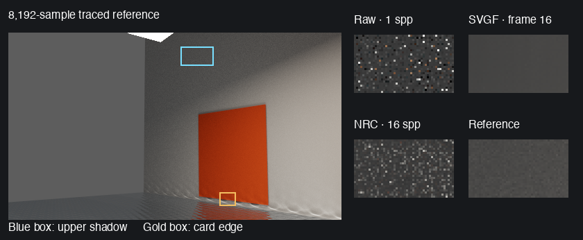

# What makes the upper-wall shadow flicker?

On the M5 Pro, freezing a warm compact NRC reduced per-pixel flicker in the dark wall above the red card by 2.2–3.7% across four seeds. The mean brightness of the entire patch fluctuated by about 3.8% frame to frame with either setting. Plain 1-spp tracing had about 2.4 times the per-pixel flicker of the training cache. The wall is dim enough that a few bright paths visibly move the estimate. In this view, changing network weights accounts for little of the observed improvement available from filtering.



## Frozen-training comparison

I fitted the camera to the four corners of the red card in the supplied screenshot. The scene, one traced bounce, four position bands, reflected direction, raw RGB target, two optimizer steps, compact tiled fp16 MLP, and six-vertex depth limit match the demo preset. Still refinement was off. Render resolution was 480 × 270. Each run warmed for 256 frames. The frozen arm used display-only inference. The online arm resumed the same cache, including its optimizer state. Each pair used the same 64 changing ray seeds at 1 spp with an empty film each frame. The first pair agreed within 0.0001 absolute luminance in all crops. Plain tracing used those same seeds. A second online arm repeated warm-up from scratch and used the live demo's still-film accumulation with an advancing Sobol sample index. Quality uses a separately seeded 8,192-spp traced reference.

Flicker below is the RMS change between successive frames, divided by the crop's mean reference luminance. The patch column averages pixels before measuring frame change, so it detects a whole patch pulsing. Values come from frames 17–64, summarized by the median across four seeds. A value above 100% is possible for individual 1-spp pixels.

| Upper shadow, one sample per frame | Per-pixel flicker | Whole-patch flicker |
|---|---:|---:|
| Plain tracing | 633% | 13.5% |
| NRC training | 262% | 3.8% |
| NRC frozen | 255% | 3.8% |

As a separate check, taking the frame change of the paired online-minus-frozen image gave 10–13% of the online change in RMS amplitude. This ratio measures sensitivity to evolving predictions on the same rays. The change in total flicker when freezing was 2.2–3.7%. The two measures include shared variation and cannot be added as independent noise fractions. The lit wall had about half the relative pixel flicker of the dark wall using online NRC.

## Getting a usable preview sooner

SVGF takes depth, normal, material and temporal history into account. The after-filter image was read at render resolution before upscaling. The pipeline uses blue-noise sampling and frame-mode outputs. Filtering comparisons use the exact same input frames on both sides. The accumulating live mode below uses its normal Sobol sampler. Each arm started the measured interval with warm weights and empty film or filter history. Error is luminance RMSE divided by mean reference luminance of the respective crop.

| Method | Upper shadow, frame 4 | Upper shadow, frame 16 | Upper shadow, frame 64 | Card edge, frame 64 |
|---|---:|---:|---:|---:|
| Accumulating live NRC | 93.0% | 45.3% | 21.5% | 23.6% |
| SVGF on online NRC | 10.0% | 9.3% | 9.4% | 30.7% |

SVGF removed 99.6% of the raw pipeline's pixel flicker over the static upper wall and 91–92% around the card edge. The filtered shadow averaged 6.8% darker than the reference, close to the raw pipeline's 5.7% dark bias. At the edge, still accumulation overtook the filter by 64 spp. For an interactive preview, keep training and show the denoised stage. For a long still, preserve the accumulating view for edge detail and evaluating bias. This stationary-camera test does not measure ghosting during camera motion or immediately after a lighting edit.

The existing stage timer measured approximately 0.8 ms for denoising and compositing at 480 × 270, by subtracting median post times with and without denoising. Timing used headless Chrome 157 on a shared M5 Pro. Treat this as a provisional stage cost. [Pipeline timing implementation](../nrc/pipeline-session.ts)

## Reproduce

Run the two pairs sequentially from the repository root. The runner saves the reference and frame-16 images under each run ID, together with crop bounds, per-seed measurements and stage timings.

```sh
node bench/runner/run.ts --page nrc-shadow-flicker --gpu apple --no-csv --ab seed=1,17
node bench/runner/run.ts --page nrc-shadow-flicker --gpu apple --no-csv --ab seed=37,59
```

Measurements from November 20, 2026 (Japan time). [Seeds 1 and 17](incoming/20261119T161907Z-nrc-shadow-flicker/run.json) · [Seeds 37 and 59](incoming/20261119T161926Z-nrc-shadow-flicker/run.json) · [Study](../pages/nrc-shadow-flicker.ts)

To compare interactively, start `node bench/live.ts nrc-pipeline` and append `?scene=nrc-materials-shadow&res=480x270&phase10=mlp&gate=off&stage=denoised` to the printed URL. With the camera parked, switch **Stage** between **Raw (render res)** and **Denoised (render res)**. The live preset starts with a new network.
