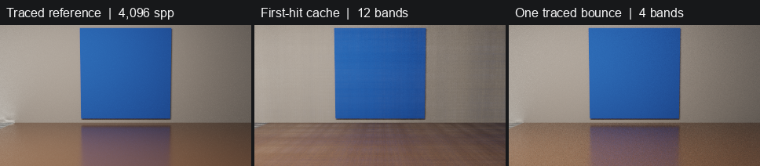

# Wall stripes, contact shadows and missing reflections

The compact NRC preserved the reflected blue card when the renderer traced the first bounce through the coated floor and used the cache at the second hit. The first-hit experiment asked the network to infer which object the glossy floor saw. Lowering the position encoding to four frequency bands also reduced axis-aligned stripes on the wall. Both changes keep the reflected-direction input, raw RGB targets and the 4,192-MAC network. Four bands trade spatial detail for smoothness and remain an experiment for other scenes. [Phase 8 direction comparison](NRC-REFLECTED-VIEW.md)



Both cache images are warm 256-sample accumulations. The blue card, wall, floor and lights are identical across panels. This camera reproduces the reported conditions. The original screenshot poses and training histories are unknown.

## What changed the image

Apple M5 Pro, Chrome 157, portable tiled fp16, 320 × 180. Each row is an independent A/B/B/A sequence, with two runs per arm and medians shown. The controls use 12 position bands, first-hit caching, two optimizer steps, and one in 16 training tiles unless the row specifies otherwise. The warm series starts after 256 online training frames and a film reset. Each image is compared in linear RGB against an independent 4,096-spp full-path reference from the same renderer. GPU times are whole cache-frame medians on a shared desktop.

| Paired change | Wall stripe RMS | Shadow-edge relative RMS | Recovered blue reflection contrast | Cache frame (ms) | Run time ID on Nov 19 UTC |
|---|---:|---:|---:|---:|---|
| First → second hit | 0.97 → 0.55% | 6.66 → 4.14% | 32 → 98% | 1.10 → 1.10 | 081619Z |
| 12 → 4 position bands | 1.03 → 0.60% | 7.20 → 6.73% | 36 → 62% | 1.10 → 1.10 | 081624Z |
| 12 → 4 bands at second hit | 0.56 → 0.55% | 4.14 → 4.06% | 98 → 99% | 1.10 → 1.10 | 082104Z |
| Tile → pixel training selection | 1.04 → 0.79% | 6.88 → 7.02% | 37 → 49% | 1.10 → 1.25 | 081621Z |
| Train 1/16 → 1/4 of tiles | 0.98 → 0.67% | 7.13 → 5.98% | 37 → 63% | 1.10 → 1.60 | 081629Z |
| Two → four optimizer steps | 1.03 → 0.78% | 6.97 → 6.34% | 33 → 21% | 1.10 → 1.30 | 081632Z |
| Bootstrap all → trace 1/16 of selected training suffixes to completion | 1.00 → 0.98% | 7.22 → 7.12% | 30 → 33% | 1.10 → 1.10 | 082101Z |

The stripe metric measures changes between adjacent row and column means of the luminance residual on the blank wall, relative to mean reference luminance. The edge metric covers narrow strips below and beside the card. Blue reflection contrast measures blue minus red under the card relative to two flanking floor patches, divided by the same contrast in the reference. Reflection-region RGB error also fell from 16.48% to 5.79% when tracing one bounce. At the first 16 samples, that bounce already recovered 75% of the reference contrast versus 1% at the first hit. [Metric regions and implementation](../nrc/card-metrics.ts)

The stripe pattern survived pixel-distributed training. With fixed weights and the same independent 64-spp ray sequence, switching training-path recording and subtraction on or off changed individual RGB values by at most 1.2e−7 across the comparisons. On this fixture the learned spatial signal accounts for visible structure. At the second hit with four bands, the held-out full-frame mean luminance bias was −0.75% and blue contrast recovery was 98.6% (082346Z). Adding occasional complete training paths moved held-out luminance bias from −0.81% to −0.78% in a separate pair (082349Z). [Recording parity check](../pages/nrc-study.ts)

On a separate grazing metal ramp, the second hit cut moving-highlight error from 0.2169 to 0.1057 and average crop relMSE from 0.0255 to 0.0057. Both arms used four bands. Five frozen camera poses were assessed at 64 spp against matching 1,024-spp references, with two runs per arm (082402Z). The motion metric compares the change in luminance of the brightest tenth of reference pixels between adjacent views. [Grazing scene and motion protocol](NRC-REFLECTED-VIEW.md)

## Training budget and recovery

On glossy Sponza, training one quarter of the tiles brought absolute mean brightness bias below 5% at the first checkpoint after the camera cut. At one sixteenth it took 32 frames in the paired run. After the lighting change, frame-64 signed bias improved from −2.54% to −0.05%, while frame-64 relMSE was 1.73 versus 1.74 and cache time rose from 2.70 to 3.65 ms. Occasional complete suffixes reached the same 5% cut threshold as their control at frame 16. They moved lighting frame-64 bias from −3.32% to −2.55%. The one-frame brightness metric is noisy. Keep the fixed two-step, one-sixteenth budget for the live preview. Recovery runs used independent 1,024-spp references, 64 warm-up frames and the second-hit four-band configuration (082545Z, 082549Z, 082552Z, 082555Z). [Original NRC training scheme](https://research.nvidia.com/publication/2021-06_real-time-neural-radiance-caching-path-tracing)

## Live demo and reproduction

Run `node bench/live.ts nrc-live --no-open` from the repository root and append the following query to the printed URL. Standard Chrome on the Mac supports this portable WebGPU path.

```text
?scene=nrc-materials-card&network=compact&directionInput=reflected&factorization=off&queryDepth=1&positionBands=4&refineStill=1&steps=2&res=640x360
```

The optional still refinement traces full paths after 64 cached samples. The early samples retain a weight of 64/N at N total samples. Moving the camera resets the film and reuses the trained weights. At 640 × 360, the smoke check counted zero cache queries during refinement, preserved the two films' mean luminance increment to within 3e−11 over 16 full-path samples, and confirmed active queries on the first frame after movement. Uncheck the option to observe the cache's long-run bias directly.

```sh
node bench/runner/run.ts --page nrc-study --gpu apple --repeat 2 --ab queryDepth=0,1 --args scene=nrc-materials-card network=compact materialInputs=evaluated directionInput=reflected factorization=off infer=tiled precision=f16 scenario=static res=320x180 ref=ours refSpp=4096 frames=16,64,256 warm=0 steps=2 flip=0
node bench/runner/run.ts --page nrc-check --gpu apple --ab fullSuffixEvery=0,1 --args check=full-tail network=compact precision=f16 infer=tiled
```

For the other card experiments, replace the A/B argument with `positionBands=12,4`, `trainSelect=tile,pixel`, `updateBlock=4,2`, `steps=2,4` (remove the fixed steps argument), or `fullSuffixEvery=0,16`. Set `queryDepth=0` for the primary-hit arms. The full-tail regression checks training targets and display reconstruction with a known black prediction in an emissive room, for display boundaries before, at and beyond the training boundary.
